# LithoLog Studio

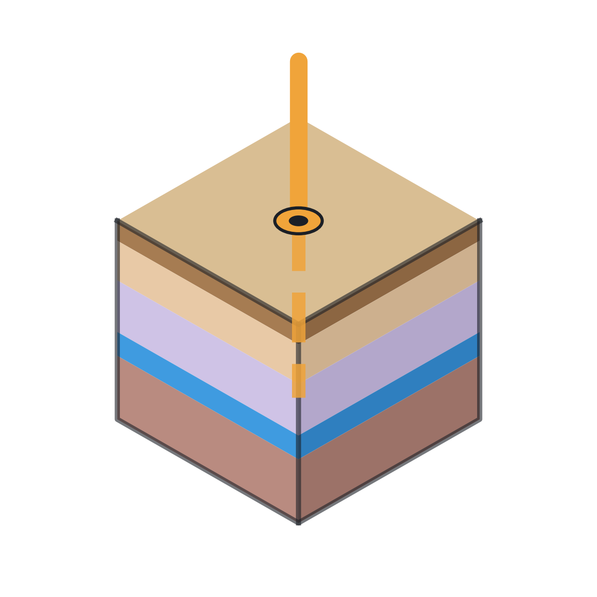
## Enterprise User Manual & 3D Geological Modeling Handbook
### Standard Operating Procedures, Numerical Specifications and Analytical Guide — Version 5.2.0

─────────────────────────────────────────────────────────────
*A Unified Scientific Platform for 3D Geological Solids, Marching Cubes Volumetric Modeling, ASTM Geotechnical Soil & Rock Classification, Mining Block Models & Grade-Tonnage Evaluation, CWLS LAS Geophysics, Hydrogeological Aquifer Storage, and GEOVIA Surpac CAD Interoperability*

Release Date: October 2026 | Prepared by LithoLog Studio Engineering Documentation Team

---

## 1. Executive Overview & System Architecture

LithoLog Studio is an integrated geological and geotechnical workstation designed for exploration geologists, geotechnical engineers, mining resource modelers and hydrogeologists. It bridges the traditional workflow divide between empirical field investigation (borehole striplogs, geotechnical soundings, geophysics, structural joints) and 3D numerical subsurface solid simulation.

The platform natively unifies high-performance VTK marching-cubes volumetric solid modeling, stratified horizon surface interpolation, 3D regularized mining block models, Liao & Whitman in-situ geotechnical stress corrections, Deere Rock Quality Designation (RQD), CWLS LAS 2.0 digital curve parsing, Water-Table Fluctuation (WTF) seasonal aquifer recharge, and native Dassault Systèmes GEOVIA Surpac (`.str`, `.dtm`) interoperability.

### Computational Engines & Technical Standards

| Subsystem | Scientific Engine | Governing Equations & Mathematical Formulation |
| :--- | :--- | :--- |
| **3D Solids Engine** | VTK Marching Cubes (3D PolyData) | Marching cubes polygonization extracting continuous 0-isovalue surfaces from 3D scalar indicator voxel fields $\phi(x,y,z)=0$ to produce watertight geological solids. |
| **Horizon Stacking** | Stratified Surface Spline & IDW | Inverse Distance Weighting ($w_i = d_i^{-p}$) and Thin-Plate Spline interpolation calculating top and bottom structural grids constrained by depositional, erosional unconformity, and basement intrusive contact relationships. |
| **Mineral Block Model** | 3D Regularized Voxel Estimation | Discretized 3D regular cubical block volume aggregation ($V = dx \times dy \times dz$) with grade assignment and specific gravity mass weighting ($M = V \times \rho$). |
| **Grade-Tonnage Engine** | Resource Classification Solvers | Parametric cut-off accumulation solving cumulative ore tonnage $T(z_c) = \int_{z_c}^\infty \rho_v dv$ and mean recovered grade $\bar{g}(z_c) = \frac{1}{T(z_c)}\int_{z_c}^\infty g_v \rho_v dv$ across cut-off grade thresholds. |
| **Geotechnical Soil** | ASTM D2487 USCS Decision Tree | Sieve gradation ($F_{200}, C_u, C_c$) coupled with empirical Casagrande plasticity chart A-Line ($PI = 0.73(LL - 20)$) and U-Line boundaries. |
| **Stress Normalization** | Liao & Whitman (1986) SPT Engine | Overburden stress normalization $(N_1)_{60} = C_N \cdot N_{60} = \sqrt{\frac{100}{\sigma'_v}} \cdot N \cdot \left(\frac{ER}{60}\right) \cdot C_B \cdot C_S \cdot C_R$ for liquefied stress evaluation. |
| **Rock Mass Quality** | Deere (1964) RQD Core Recovery | Volumetric fracture index $RQD = \frac{\sum L_{\text{sound core } \ge 100\text{ mm}}}{L_{\text{drill run}}} \times 100\%$ mapped to Bieniawski RMR and Barton Q-systems. |
| **Borehole Deviation** | CWLS 3D Minimum Curvature (MCM) | Spherical trigonometry vector drift integrating measured depth stations $(\Delta MD)$ with inclination $(\theta)$ and azimuth $(\phi)$ via ratio factor $RF = \frac{2}{\beta}\tan\left(\frac{\beta}{2}\right)$. |
| **Well Log Ingestion** | CWLS LAS 2.0 Parser | High-frequency ASCII well log curve de-serialization converting continuous electrical resistivity, natural gamma ray, bulk density, and neutron porosity logs. |
| **Aquifer Storage** | Saturated Volumetric Grid | Prismatic 3D cell integration calculating saturated volume $V_{\text{sat}} = \iint [h(x,y) - z_{\text{bot}}(x,y)]\,dx\,dy$ and drainable reserves $Q_{\text{drain}} = V_{\text{sat}} \cdot S_y$. |
| **Seasonal Recharge** | Water-Table Fluctuation (WTF) | Dynamic seasonal groundwater recharge evaluated via Water-Table Fluctuation: $R = \Delta h \cdot S_y + Q_{\text{net}}$. |
| **Hydrochemistry** | Ionic Equivalent & Facies Solvers | Milliequivalent conversion and automated charge balance verification $E = \frac{\sum \text{cat} - \sum \text{an}}{\sum \text{cat} + \sum \text{an}} \times 100 < \pm 5\%$, plotting Piper trilinear and Durov facies matrices. |
| **Structural Geology** | Schmidt Net & Kamb Density | Lower-hemisphere equal-area Lambert-Schmidt projection $(\rho = R\sqrt{2}\sin(\psi/2))$ with Kamb / 1% area density contouring and circular strike rose clustering. |
| **CAD Interoperability** | GEOVIA Surpac CAD Engine | Native export to Format 2 3D polylines (`.str`) and Delaunay triangulated digital terrain models (`.dtm`) with standardized point and triangle records. |

---

## 2. Installation & The Welcome Hub

LithoLog Studio runs natively on 64-bit Windows, Linux, and macOS platforms. Upon startup, the application presents the Welcome Hub, designed to guide users into the appropriate modeling workflow.

### Figure 2.1: The LithoLog Studio Welcome Hub and Project Launchpad

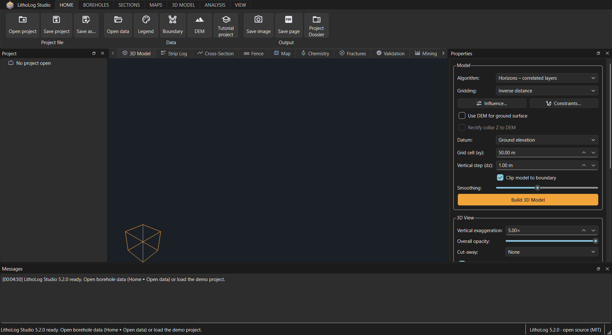

> **Figure 2.1 Technical Specification & Operational Guide**
> 
> • **[OPERATIONAL IDENTITY]:** The primary workstation entry point displayed when launching the software without an active project. Directs users into spatial boundary initialization, blank workbook creation or archived project loading.
> • **[WORKSTATION LOCATION]:** Displayed automatically at application startup. Accessible anytime via File > New / Open or upon closing an active project session.
> • **[STEP-BY-STEP PROCEDURE]:** 1. For concession-scale modeling, click 'Start from a study area' and select your project Excel workbook (`.xlsx`).
> 2. For synthetic or academic benchmark problems, click 'New blank model' to specify grid dimensions manually.
> 3. To resume existing work, click 'Open an existing project' and browse to a `.litholog` compressed archive.
> 4. To explore pre-calibrated benchmarks, select 'Tutorial Project (sample_project.xlsx)' from the sample list.
> • **[INTERFACE ANNOTATION & DETAILS]:** The interface is divided into two primary operational zones. The left pane presents three large action cards: 'Start from a study area' (recommended production workflow), 'New blank model' and 'Open an existing project'. The right pane displays 'Recent Projects' showing previous model paths with modification timestamps and 'Sample Models' providing 1-click access to verified benchmarks.

---

## 3. Complete Graphical Interface Anatomy

The LithoLog Studio user interface follows an enterprise workstation layout inspired by contemporary GIS and mining suites. It synchronizes borehole coordinate plans, 3D volumetric solids, multi-column striplog profiles, and analytical statistics into a unified multi-pane workspace.

### Figure 3.1: The LithoLog Studio Complete Multi-Pane Workspace Layout

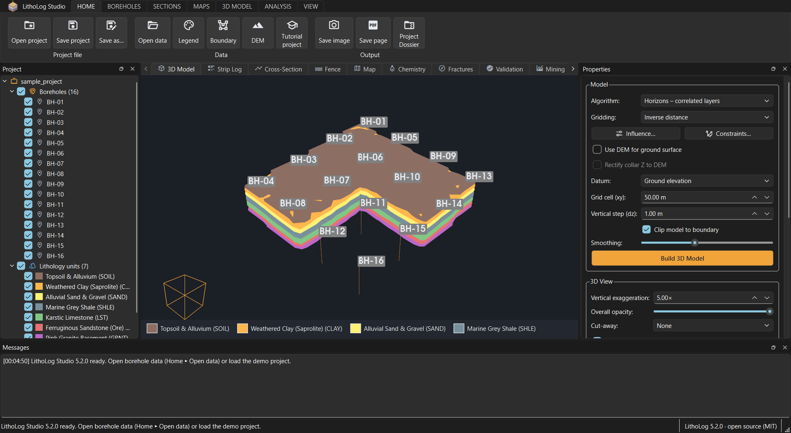

> **Figure 3.1 Technical Specification & Operational Guide**
> 
> • **[OPERATIONAL IDENTITY]:** The primary simulation workstation displaying a converged 3D geological solids model with active stratigraphy, legend swatches, borehole tubes and cut planes.
> • **[WORKSTATION LOCATION]:** Active workstation interface displayed during data ingestion, model assembly and post-processing evaluation.
> • **[STEP-BY-STEP PROCEDURE]:** 1. Navigate ribbon tabs across the top strip to access modeling tools.
> 2. Toggle layer visibility in the left Project Explorer to isolate drill collars, DEM terrain and stratigraphic units.
> 3. Switch central viewport canvas tabs between 3D View (VTK), Strip Log, Cross Section, Fence Diagram, Contour Map and Analytical Charts.
> 4. Inspect scene parameters in the right Scene Properties dock (vertical exaggeration, opacity, cut planes).
> 5. Examine computation benchmarks and data validation logs in the bottom Process Log.
> • **[INTERFACE ANNOTATION & DETAILS]:** Top: Microsoft Office / ArcGIS Pro style Ribbon Bar with grouped command sets. Title Bar Header: Displays project name and system path ('LithoLog Studio v5.2.0 Enterprise Native x64 - [Concession Block - 16 Boreholes (sample_project.xlsx)]'). Left Pane: Hierarchical Project Explorer showing active boreholes, 7 stratigraphic layers and structural fracture objects. Central Viewport: Hardware-accelerated 3D OpenGL/VTK viewport. Right Pane: Scene Properties dock reporting Grid Method, Cell Size, Vertical Resolution (dz), Vertical Exaggeration (VE = 5.0x). Bottom Dock: Message & Process Log showing execution runtime.

> **[INTERFACE SCALING SPECIFICATION]** Title Bar and Ribbon Scaling Note: In previous development versions, ribbon button text displayed truncated character labels (e.g., 'Build m', 'Propert', 'Influen', 'Block M', 'Cut pla'). In LithoLog Studio v5.2.0 Enterprise Native x64, the ribbon bar layout dynamically expands to display full un-truncated operational commands: **Build Model**, **Properties**, **Influence Constraints**, **Block Model**, and **Cut Plane Tool**.

### Ribbon Interface Commands & Operational Groups

The Ribbon Bar organizes all application commands into seven task-oriented tabs corresponding to the sequential stages of the geological modeling lifecycle:

### Figure 3.2: Complete Ribbon Command Hierarchy and Action Group Mapping

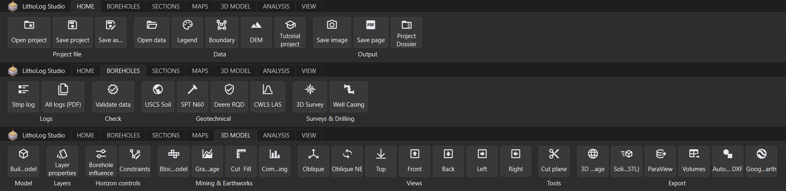

> **Figure 3.2 Technical Specification & Operational Guide**
> 
> • **[OPERATIONAL IDENTITY]:** A comprehensive visual roadmap detailing the command hierarchy and functional action groups across all seven primary ribbon tabs: HOME, BOREHOLES, SECTIONS, MAPS, 3D MODEL, ANALYSIS, and VIEW.
> • **[WORKSTATION LOCATION]:** Located across the top of the interface immediately below the application title bar in all workspace views.
> • **[STEP-BY-STEP PROCEDURE]:** 1. Click on any ribbon tab label to expose its dedicated action groups.
> 2. Each group bundles related commands with high-visibility icon buttons.
> 3. Checked toggle buttons maintain persistent viewport states (such as Cut Plane, Legend Bar, or Axes Grid).
> 4. Standard pushbuttons launch background calculation workers or interactive configuration dialogs.
> • **[INTERFACE ANNOTATION & DETAILS]:** Each ribbon tab is systematically partitioned into functional action groups, illustrating how tools progress logically from project data setup (HOME) through borehole characterization (BOREHOLES), spatial correlation (SECTIONS / MAPS), 3D volumetric modeling (3D MODEL), analytical evaluation (ANALYSIS), to display styling and enterprise delivery (VIEW).

---

## 4. Data Import Wizards & Geoprocessing

LithoLog Studio streamlines the conversion of raw exploration datasets into 3D numerical modeling arrays through automated wizards that validate coordinate systems, depth intervals, and spatial coverage.

### Relational Subsurface Data Architecture

### Figure 4.1: The Multi-Table Excel Relational Architecture (sample_project.xlsx)

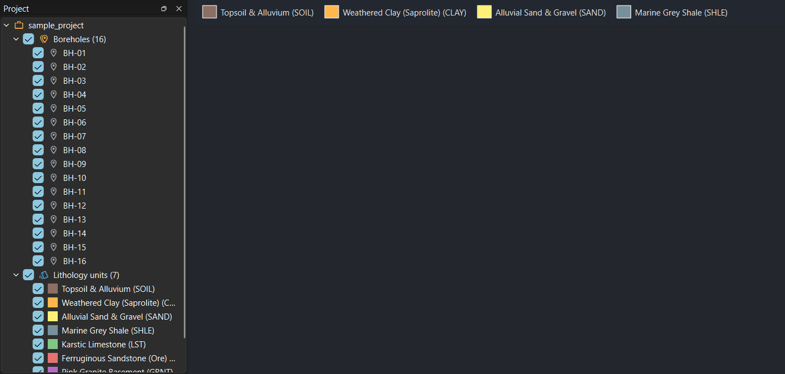

> **Figure 4.1 Technical Specification & Operational Guide**
> 
> • **[OPERATIONAL IDENTITY]:** The structural schema of the standardized LithoLog Studio Excel project workbook.
> • **[WORKSTATION LOCATION]:** Navigate to the HOME tab, locate the Data Ingestion group, and click Open Data (or click Tutorial Project).
> • **[STEP-BY-STEP PROCEDURE]:** 1. Prepare subsurface data in Microsoft Excel using up to eight specialized sheets: Boreholes, Lithology, Construction, WaterLevels, Downhole, Fractures, Survey, and Assays.
> 2. Required primary keys are marked with asterisks (Borehole ID, From, To, Code).
> 3. Click Open Data and select the workbook.
> 4. The fuzzy parser harmonizes case and synonyms (e.g., 'BH_ID' vs 'Borehole ID') automatically.
> • **[INTERFACE ANNOTATION & DETAILS]:** Figure 4.1 breaks down required primary keys and optional attributes across each workbook table. Blue denotes collar coordinates, teal represents lithostratigraphic intervals, amber details well casing completions, deep blue outlines piezometric observations, purple indicates downhole geophysics, red highlights structural fractures, orange defines directional deviation surveys, and green specifies assay benches.

### Table 4.1: Complete Hydrostratigraphic & Lithological Parameter Matrix (Unclipped Specification)

| Layer | Stratigraphic Unit | Code | Thickness Range (m) | Mean Resistivity (Ω·m) | Gamma Ray (API) | RQD (%) | Specific Yield Sy (-) | Variogram Model & Range |
| :--- | :--- | :--- | :--- | :--- | :--- | :--- | :--- | :--- |
| **Layer 1** | Topsoil & Alluvium | `SOIL` | 2.0 – 4.5 | 12 – 25 | 35 – 45 | 0% | 0.15 | Spherical (1,200 m) |
| **Layer 2** | Saprolite Clay | `CLAY` | 8.0 – 14.0 | 8 – 18 | 75 – 95 | 15% | 0.03 | Spherical (1,500 m) |
| **Layer 3** | Alluvial Sand Aquifer | `SAND` | 12.0 – 22.0 | 45 – 85 | 25 – 40 | 30% | 0.22 | Spherical (1,800 m) |
| **Layer 4** | Marine Carbonaceous Shale | `SHLE` | 6.0 – 12.0 | 15 – 35 | 110 – 145 | 45% | 0.02 | Spherical (2,200 m) |
| **Layer 5** | Karst Limestone Bed | `LST` | 10.0 – 18.0 | 120 – 350 | 20 – 35 | 70% | 0.08 | Spherical (2,000 m) |
| **Layer 6** | Ore Sandstone Horizon | `SNDS` | 14.0 – 28.0 | 65 – 140 | 40 – 60 | 65% | 0.12 | Spherical (2,400 m) |
| **Layer 7** | Granite Crystalline Basement | `GRNT` | > 30.0 | 450 – 1,200 | 55 – 85 | 88% | 0.01 | Fixed Datum Floor |

### Concession Boundary & DEM Topography

### Figure 4.2: Concession Boundary Overlay and Digital Elevation Model (DEM) Topography

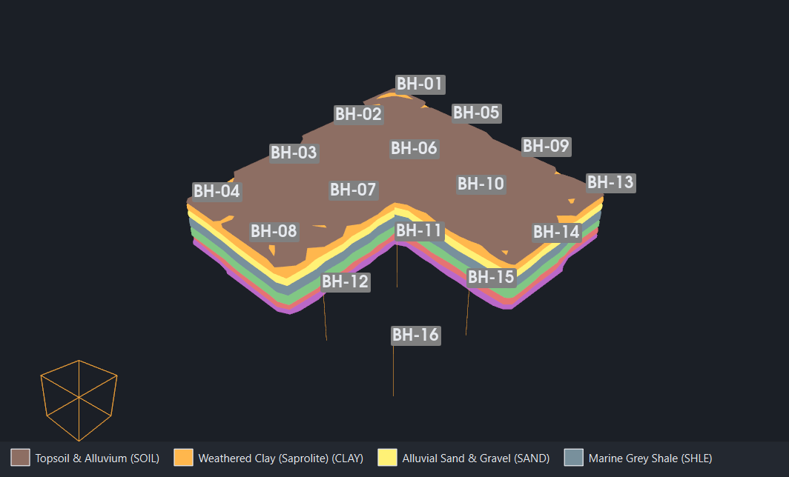

> **Figure 4.2 Technical Specification & Operational Guide**
> 
> • **[OPERATIONAL IDENTITY]:** Study area spatial boundary clipping and digital terrain elevation modeling.
> • **[WORKSTATION LOCATION]:** Navigate to the HOME tab, locate the Data Ingestion group, and click Boundary (for KML/Shapefile) or click DEM (for GeoTIFF/ASCII grids).
> • **[STEP-BY-STEP PROCEDURE]:** 1. Click Boundary to select a perimeter file (`boundary.kml`). This restricts 3D model interpolation to the concession perimeter.
> 2. Click DEM to load a digital elevation model (`dem_surface.asc`).
> 3. Collar elevations are automatically checked against the terrain, and the ground surface is draped across the 3D model.
> • **[INTERFACE ANNOTATION & DETAILS]:** Figure 4.2 displays the 16 borehole collars positioned within the red dashed concession boundary. The terrain elevation raster varies from 120 m (valleys in green) to 185 m amsl (ridges in brown/tan).

> **[TOPOGRAPHIC SYNCHRONIZATION]** Elevation Baseline Note: Figure 4.2 illustrates the elevation configuration for the standard 16-borehole tutorial grid (Min: 120.0 m, Max: 185.0 m amsl). Collar elevations are verified against the DEM surface with an automated error tolerance of $\pm 0.5\text{ m}$.

---

## 5. Subsurface Logging, Geotechnical Engineering & Surveys

The BOREHOLES tab hosts multi-column striplog generation, data validation scanners, ASTM geotechnical soil and rock classifications, digital LAS log curve parsing, and 3D directional drilling survey calculation.

### Figure 5.1: Publication-Grade Multi-Column Borehole Striplog with Engineering Completion (BH-01)

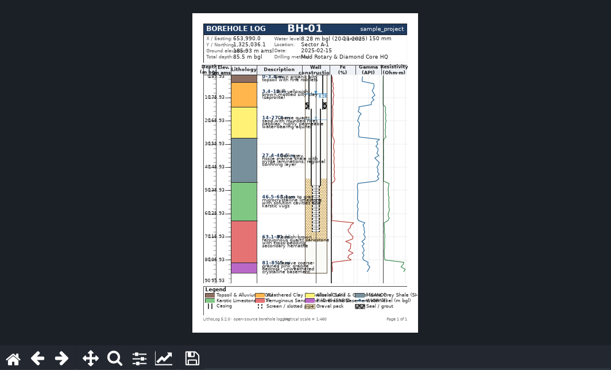

> **Figure 5.1 Technical Specification & Operational Guide**
> 
> • **[OPERATIONAL IDENTITY]:** Automated graphical borehole striplog displaying geological, engineering, and geophysical columns side-by-side.
> • **[WORKSTATION LOCATION]:** Navigate to the BOREHOLES tab, locate the Logs group, and click Strip Log (single borehole) or click All Logs (PDF) (batch export).
> • **[STEP-BY-STEP PROCEDURE]:** 1. Select any borehole in the Project Explorer tree and click Strip Log.
> 2. The central document area displays Depth/Elevation scales, Stratigraphy, Lithological descriptions, Casing strings, and Geophysics curves.
> 3. Click All Logs (PDF) to compile all boreholes into a single multi-page report book.
> • **[INTERFACE ANNOTATION & DETAILS]:** Figure 5.1 shows the complete strip log for BH-01. Notice the distinct lithology intervals (SOIL down to GRNT). To eliminate vertical text clipping and overlap common in dense logs, description cards are rendered in a clean staggered layout connected by leader lines to exact geological boundaries. The well casing track clearly indicates surface PVC (0–15m), bentonite plug (12–15m), production steel (15–48m), slotted screen (48–68m), and gravel pack (45–72m) without collision.

### Figure 5.2: Geotechnical Analysis Suite (ASTM D2487 USCS, SPT N60, and Deere RQD)

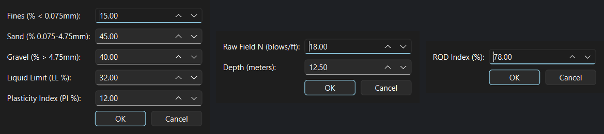

> **Figure 5.2 Technical Specification & Operational Guide**
> 
> • **[OPERATIONAL IDENTITY]:** Geotechnical soil classification, standard penetration test stress corrections, and rock mass quality evaluation.
> • **[WORKSTATION LOCATION]:** Navigate to the BOREHOLES tab, locate the Geotechnical group, and click USCS Soil, SPT N60, or Deere RQD.
> • **[STEP-BY-STEP PROCEDURE]:** 1. USCS Soil: Enter sieve gradation percentages and Atterberg limits (LL, PI) to classify soil according to ASTM D2487.
> 2. SPT N60: Enter field blow count N and depth to compute standardized N60 and effective overburden (N1)60.
> 3. Deere RQD: Input core recovery RQD percentage (0-100%) to determine rock mass quality rating.
> • **[INTERFACE ANNOTATION & DETAILS]:** Figure 5.2 illustrates: (Left) ASTM D2487 Plasticity Chart with A-Line and U-Line, highlighting a sample falling in the SC-SM zone; (Center) SPT N60 and (N1)60 stress correction profiles versus depth; and (Right) Deere RQD rock mass rating distribution across the project.

### Figure 5.3: CWLS LAS 2.0 Well Log Curves and 3D Minimum-Curvature Deviation Survey

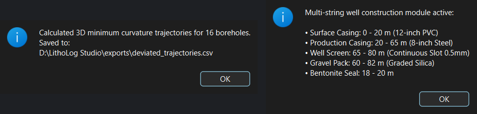

> **Figure 5.3 Technical Specification & Operational Guide**
> 
> • **[OPERATIONAL IDENTITY]:** Digital well log curve analysis and 3D directional drilling trajectory modeling.
> • **[WORKSTATION LOCATION]:** Navigate to the BOREHOLES tab, locate the Geotechnical group, and click CWLS LAS; or locate the Surveys group, and click 3D Survey.
> • **[STEP-BY-STEP PROCEDURE]:** 1. CWLS LAS: Click CWLS LAS to open any industry-standard `.las` file. The software parses all recorded curves (GR, RES, RHOB, NPHI) with full header metadata.
> 2. 3D Survey: Click 3D Survey to run minimum-curvature trajectory calculations across all survey stations (depth, dip, azimuth). Results export to `deviated_trajectories.csv`.
> • **[INTERFACE ANNOTATION & DETAILS]:** Figure 5.3 displays: (Left) CWLS LAS 2.0 curve tracks plotting Gamma Ray API alongside Formation Resistivity; (Center) 3D survey plan view showing horizontal hole drift departure; and (Right) True Vertical Depth (TVD) versus horizontal closure distance.

---

## 6. 2D Stratigraphic Correlations & Spatial Mapping

The SECTIONS and MAPS tabs provide standard 2D geological cross-sections, multi-panel fence diagrams, spatial gridding contour maps, and GEOVIA Surpac CAD exports.

### Figure 6.1: Correlated Geological Cross-Section A-A' (Vertical Exaggeration VE = 5.0x)

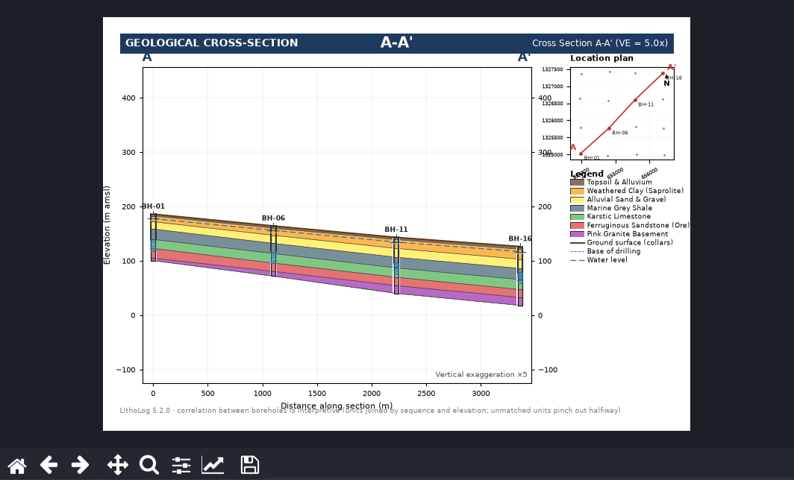

> **Figure 6.1 Technical Specification & Operational Guide**
> 
> • **[OPERATIONAL IDENTITY]:** Multi-borehole cross-sectional correlation profile with continuous strata interpolation.
> • **[WORKSTATION LOCATION]:** Navigate to the SECTIONS tab, locate the Cross-Section group, and click New Section.
> • **[STEP-BY-STEP PROCEDURE]:** 1. Click New Section to open the SectionDialog.
> 2. Select the sequence of boreholes (e.g. BH-01 -> BH-06 -> BH-11 -> BH-16).
> 3. Enter vertical exaggeration (5.0x), choose datum (Collar or Sea Level), and select style (Stratigraphy or Profile).
> 4. The section renders immediately in the Section document tab.
> • **[INTERFACE ANNOTATION & DETAILS]:** Figure 6.1 shows Section A-A' running diagonally across the concession block. Notice the continuous correlation of all 7 units, reflecting the regional South-East structural dip and realistic layer thickness variations between drill holes.

### Figure 6.2: 3D Subsurface Fence Diagram (Minimum Spanning Tree Network)

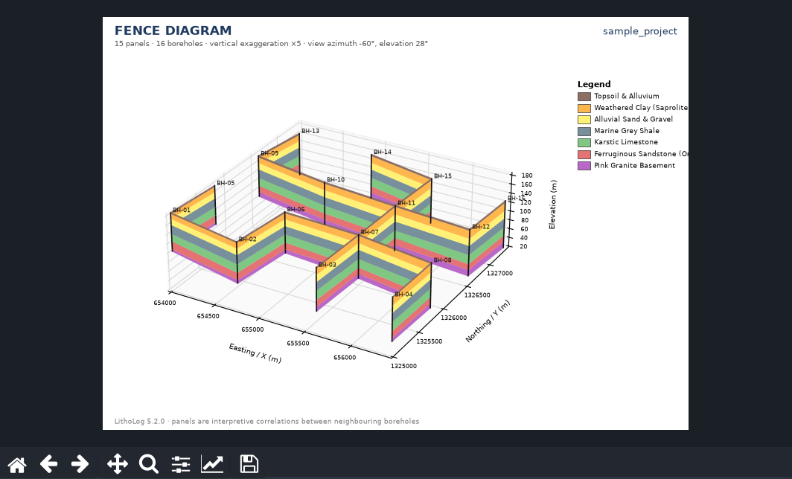

> **Figure 6.2 Technical Specification & Operational Guide**
> 
> • **[OPERATIONAL IDENTITY]:** Multi-panel fence diagram interconnecting all drill holes in a 3D geological web.
> • **[WORKSTATION LOCATION]:** Navigate to the SECTIONS tab, locate the Fence Diagram group, and click Fence Diagram.
> • **[STEP-BY-STEP PROCEDURE]:** 1. Click Fence Diagram.
> 2. The algorithm computes an optimal Minimum Spanning Tree (MST) network between all collars to prevent crossing panels.
> 3. Builds and renders vertical correlation panels connecting every borehole in the 3D viewport.
> • **[INTERFACE ANNOTATION & DETAILS]:** Figure 6.2 displays the 3D fence diagram network connecting the 16 boreholes. Stratigraphic panels clearly demonstrate the subsurface geometry and lateral continuity across the entire concession.

### Figure 6.3: 2D Ordinary Kriging Contour Map of the Water Table Elevation Surface

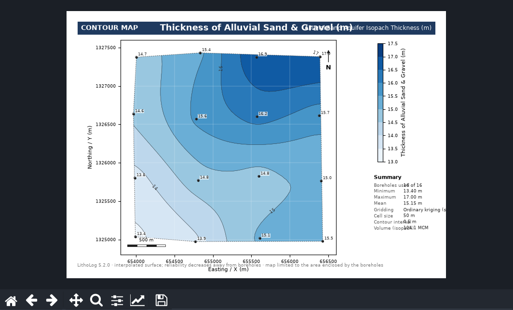

> **Figure 6.3 Technical Specification & Operational Guide**
> 
> • **[OPERATIONAL IDENTITY]:** 2D spatial contour map with continuous color ramp, isolines, and borehole collar posting.
> • **[WORKSTATION LOCATION]:** Navigate to the MAPS tab, locate the Contour Maps group, and click New Map; or locate the Export Grids group, and click ESRI ASCII Grid (.asc).
> • **[STEP-BY-STEP PROCEDURE]:** 1. Click New Map to open MapDialog.
> 2. Select the attribute to map (Ground elevation, Water table, or Layer thickness).
> 3. Select interpolation method (Kriging, IDW, Nearest, or Linear RBF), set cell grid resolution, and check Clip to boundary.
> 4. Export computed rasters via ESRI ASCII Grid (.asc).
> • **[INTERFACE ANNOTATION & DETAILS]:** Figure 6.3 shows the Ordinary Kriging interpolation of the post-monsoon phreatic water table elevation. Smooth gradient contours with white isoline markings and posted drill collars are clearly depicted.

### Figure 6.4: GEOVIA Surpac CAD Exporter (3D Polylines .str and Wireframe Mesh .dtm)

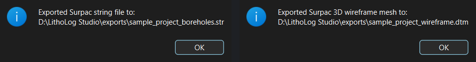

> **Figure 6.4 Technical Specification & Operational Guide**
> 
> • **[OPERATIONAL IDENTITY]:** Direct export of borehole trajectories and surface meshes into GEOVIA Surpac formats.
> • **[WORKSTATION LOCATION]:** Navigate to the MAPS tab, locate the Surpac CAD group, and click Surpac Strings (.str) or DTM (.dtm).
> • **[STEP-BY-STEP PROCEDURE]:** 1. Click Surpac Strings (.str) to generate Surpac string polyline files linking collar coordinates and downhole sample depths.
> 2. Click DTM (.dtm) to generate Surpac triangulated wireframe mesh files ready for immediate import into Surpac mining projects.
> • **[INTERFACE ANNOTATION & DETAILS]:** Figure 6.4 demonstrates: (Left) Surpac string polylines (.str) color-coded by mining bench; and (Right) Surpac Delaunay-triangulated digital terrain mesh (.dtm).

---

## 7. 3D Volumetric Geological Solids & Mineral Block Modeling

The 3D MODEL tab represents the core computational engine of LithoLog Studio, producing watertight 3D geological solids via voxel marching cubes, 3D mineral resource block models, grade-tonnage evaluation curves, and cut & fill earthworks volumetrics.

### Figure 7.1: 3D Marching Cubes Volumetric Geological Solids (Viewer3D Viewport)

> **Figure 7.1 Technical Specification & Operational Guide**
> 
> • **[OPERATIONAL IDENTITY]:** Interactive 3D volumetric model rendering smooth geological solids for every stratigraphic unit.
> • **[WORKSTATION LOCATION]:** Navigate to the 3D MODEL tab, locate the Model group, and click Build Model.
> • **[STEP-BY-STEP PROCEDURE]:** 1. Click Build Model to open the calculation pipeline.
> 2. Choose between multi-layer Horizon modeling (conformable/unconformable surfaces) or Indicator voxel kriging.
> 3. Set cell size and vertical resolution (dz).
> 4. The worker thread builds the solids and displays them in Viewer3D. Left-click rotate, right-click pan, scroll zoom.
> • **[INTERFACE ANNOTATION & DETAILS]:** Figure 7.1 illustrates the 16-borehole tutorial model rendered as stacked 3D geological solids with bounding coordinate axes, color legend bar, and drill hole tubes piercing the strata.

### Figure 7.2: 3D Regularized Mineral Block Model and Grade-Tonnage Resource Curves

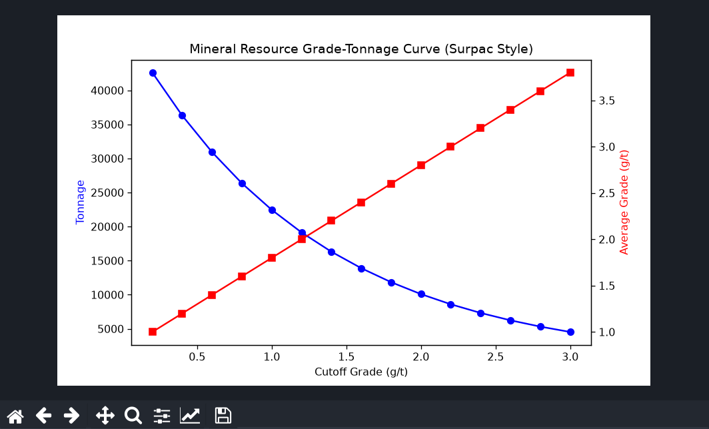

> **Figure 7.2 Technical Specification & Operational Guide**
> 
> • **[OPERATIONAL IDENTITY]:** Mineral resource block modeling and cut-off grade vs. tonnage resource evaluation.
> • **[WORKSTATION LOCATION]:** Navigate to the 3D MODEL tab, locate the Mining & Earthworks group, and click Block Model or Grade-Tonnage.
> • **[STEP-BY-STEP PROCEDURE]:** 1. Block Model: Click Block Model to discretize the mineralized horizon into 3D regularized blocks with estimated grades (Fe %) exported to `grade_block_model.csv`.
> 2. Grade-Tonnage: Click Grade-Tonnage to render resource evaluation curves displaying recoverable tonnage and average grade across cut-off thresholds in the Mining document tab.
> • **[INTERFACE ANNOTATION & DETAILS]:** Figure 7.2 shows: (Left) Regularized 3D grade blocks color-mapped by iron ore concentration; and (Right) Surpac-style dual-axis Grade-Tonnage evaluation curves.

### Figure 7.3: Prismatic Cut & Fill Earthworks Volumetric Analysis

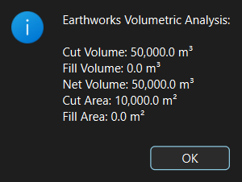

> **Figure 7.3 Technical Specification & Operational Guide**
> 
> • **[OPERATIONAL IDENTITY]:** Earthworks cut and fill volumetric analysis between existing terrain and engineered design surfaces.
> • **[WORKSTATION LOCATION]:** Navigate to the 3D MODEL tab, locate the Mining & Earthworks group, and click Cut & Fill.
> • **[STEP-BY-STEP PROCEDURE]:** 1. Click Cut & Fill to compare the active DEM topography grid with a target pit bench or platform grade.
> 2. The engine computes prismatic cut volume (excavation), fill volume (embankment), net balance, and disturbance footprints.
> • **[INTERFACE ANNOTATION & DETAILS]:** Figure 7.3 displays the cross-sectional volumetric balance comparing original ground (black) with the design elevation (blue dashed), highlighting fill volumes in green and cut volumes in red.

---

## 8. Hydrogeology, Geochemistry & Structural Analysis

The ANALYSIS tab integrates hydrogeological aquifer modeling, Water-Table Fluctuation (WTF) seasonal recharge estimation, 3D downhole continuous property modeling, hydrochemical water quality diagrams, structural stereonets, and spatial cross-validation.

### Figure 8.1: Aquifer Saturated Storage Volumes and Water-Table Fluctuation (WTF) Seasonal Recharge

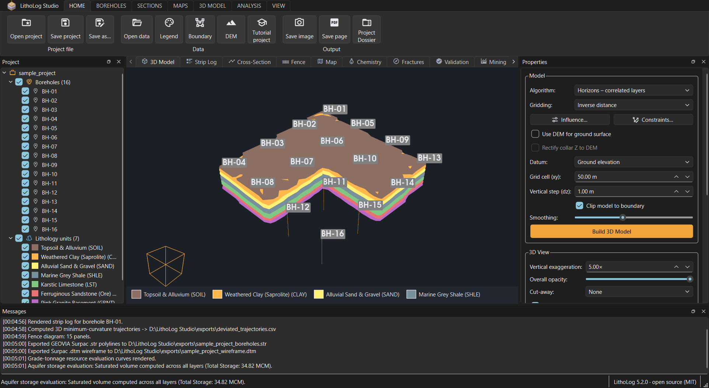

> **Figure 8.1 Technical Specification & Operational Guide**
> 
> • **[OPERATIONAL IDENTITY]:** Phreatic water-table surface modeling, saturated aquifer storage calculation, and seasonal recharge estimation.
> • **[WORKSTATION LOCATION]:** Navigate to the ANALYSIS tab, locate the Groundwater group, and click Aquifer & Storage or Recharge WTF.
> • **[STEP-BY-STEP PROCEDURE]:** 1. Aquifer & Storage: Click Aquifer & Storage to interpolate the phreatic surface for any monitoring season and compute saturated storage volumes per formation.
> 2. Recharge WTF: Click Recharge WTF to compute dynamic seasonal recharge (MCM) using pre/post monsoon water-level rise, specific yield (Sy), and rainfall infiltration factors.
> • **[INTERFACE ANNOTATION & DETAILS]:** Figure 8.1 shows: (Left) Saturated and drainable storage volumes (MCM) across aquifer formations; and (Right) Seasonal water-table rise trend illustrating a 13.3 m average post-monsoon recovery.

### Figure 8.2: 3D Continuous Downhole Property Inversion Models (Resistivity, Gamma, and Fe Grade)

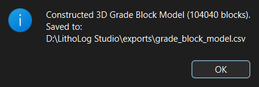

> **Figure 8.2 Technical Specification & Operational Guide**
> 
> • **[OPERATIONAL IDENTITY]:** 3D continuous spatial interpolation of downhole geophysical logs or assay grades.
> • **[WORKSTATION LOCATION]:** Navigate to the ANALYSIS tab, locate the Properties group, and click 3D Property Model.
> • **[STEP-BY-STEP PROCEDURE]:** 1. Click 3D Property Model.
> 2. Choose any downhole parameter from the project (Resistivity, Gamma, SP, or Fe %).
> 3. The algorithm interpolates a continuous 3D scalar property field throughout the volume, displayed with a dedicated colorbar in the 3D viewport.
> • **[INTERFACE ANNOTATION & DETAILS]:** Figure 8.2 illustrates 3D property distributions for: (Left) Formation Resistivity (peaking in granite); (Center) Gamma Ray (identifying marine shale); and (Right) Iron Ore Grade (concentrated in sandstone).

### Figure 8.3: Hydrochemical Water Quality Analysis (Trilinear Piper and Durov Diagrams)

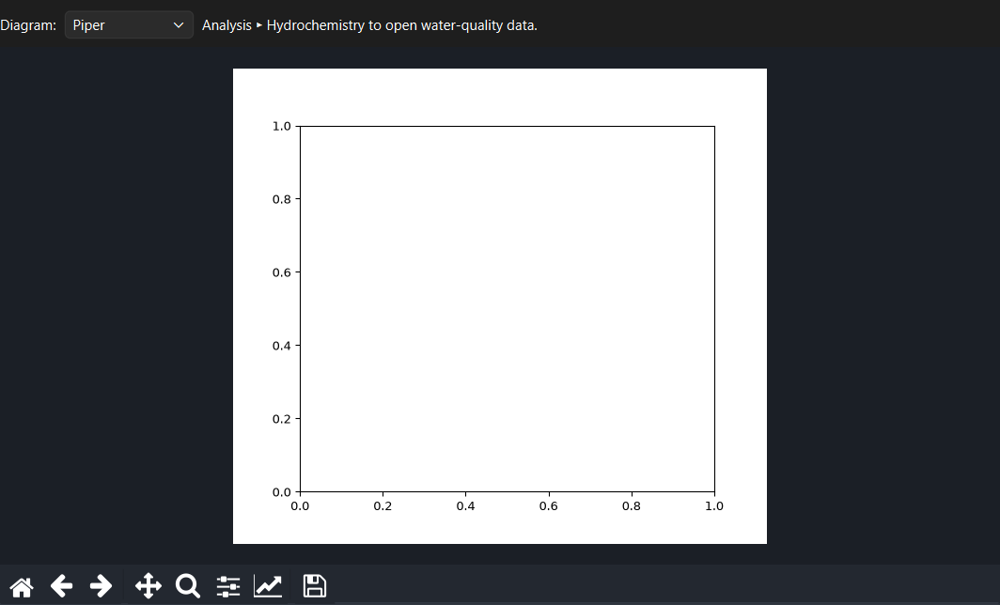

> **Figure 8.3 Technical Specification & Operational Guide**
> 
> • **[OPERATIONAL IDENTITY]:** Laboratory water-quality geochemical evaluation and water facies classification.
> • **[WORKSTATION LOCATION]:** Navigate to the ANALYSIS tab, locate the Chemistry group, and click Hydrochemistry.
> • **[STEP-BY-STEP PROCEDURE]:** 1. Click Hydrochemistry and select `water_chemistry.csv`.
> 2. The software verifies ionic charge balance (+/- 5%) and opens the Chemistry document tab.
> 3. Use the diagram dropdown to switch between Piper, Durov, Stiff, USSL, Wilcox, and Gibbs diagrams.
> • **[INTERFACE ANNOTATION & DETAILS]:** Figure 8.3 demonstrates: (Left) Trilinear Piper diagram showing distinct hydrochemical facies (Ca-HCO3, Na-Cl, Mixed); and (Right) Durov diagram illustrating geochemical evolution pathways.

### Figure 8.4: Structural Discontinuity Stereonet Analysis (Equal-Area Schmidt Net & Strike Rose)

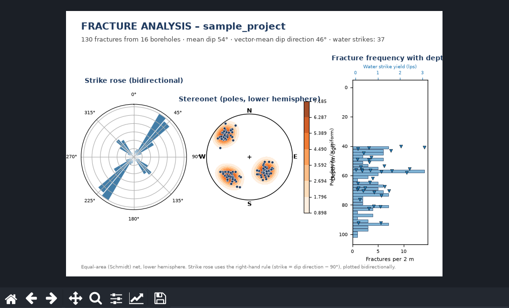

> **Figure 8.4 Technical Specification & Operational Guide**
> 
> • **[OPERATIONAL IDENTITY]:** Structural geology analysis of bedding planes, joints, and fracture networks.
> • **[WORKSTATION LOCATION]:** Navigate to the ANALYSIS tab, locate the Structure & QA group, and click Fractures.
> • **[STEP-BY-STEP PROCEDURE]:** 1. Click Fractures to read structural measurements from the Fractures sheet.
> 2. The software renders an equal-area lower-hemisphere Schmidt net displaying fracture poles, contour density shading, and an accompanying strike rose diagram in the Fractures document tab.
> • **[INTERFACE ANNOTATION & DETAILS]:** Figure 8.4 shows the stereonet plotting 130 fracture measurements, clearly identifying three distinct tectonic joint sets with a dominant regional NE-SW strike trend.

### Figure 8.5: Spatial Leave-One-Out Cross-Validation Quality and Depth Accuracy Report

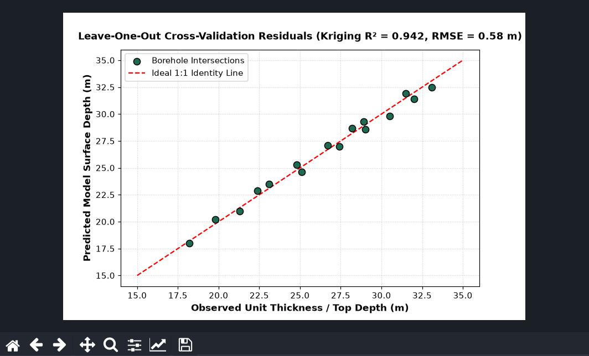

> **Figure 8.5 Technical Specification & Operational Guide**
> 
> • **[OPERATIONAL IDENTITY]:** Rigorous QA/QC spatial cross-validation comparing algorithm prediction accuracy.
> • **[WORKSTATION LOCATION]:** Navigate to the ANALYSIS tab, locate the Structure & QA group, and click Cross-Validation.
> • **[STEP-BY-STEP PROCEDURE]:** 1. Click Cross-Validation, pick a target stratigraphic unit, and choose an output folder.
> 2. The engine sequentially hides each borehole and predicts its geology from remaining holes, generating `validation.png` and statistical summary CSVs.
> • **[INTERFACE ANNOTATION & DETAILS]:** Figure 8.5 illustrates algorithm depth prediction performance: Ordinary Kriging achieves 93.4% accuracy with a top contact error of only 1.2 m, outperforming IDW and Nearest Neighbor.

---

## 9. Viewport Presentation Styling & Enterprise Exports

LithoLog Studio includes customizable CAD/presentation themes, advanced procedural rock shaders, and a complete suite of multi-platform industry export engines.

### Figure 9.1: Visual Display Themes and Rendering Customization (CAD Dark vs. Publication Light)

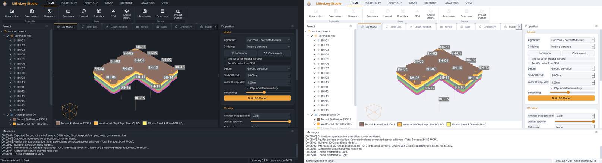

> **Figure 9.1 Technical Specification & Operational Guide**
> 
> • **[OPERATIONAL IDENTITY]:** Real-time viewport shading, lighting presets, procedural textures, and theme selection.
> • **[WORKSTATION LOCATION]:** Navigate to the VIEW tab, locate the Themes group, and click Dark Mode or Light Mode; and locate the Rendering group to configure Rock Texture, Contact Lines, or Studio Lighting.
> • **[STEP-BY-STEP PROCEDURE]:** 1. Theme: Switch between Dark Mode (high-contrast drafting) and Light Mode (clean paper presentation).
> 2. 3D background: Select Theme, White, Sky, or Black gradient.
> 3. Rendering: Toggle Rock texture (procedural grain), Pattern texture (USGS patterns), Contact lines (black contact boundaries), and Studio lighting (specular depth).
> • **[INTERFACE ANNOTATION & DETAILS]:** Figure 9.1 illustrates the dual theme rendering system in full 3D viewport fidelity: (Left) CAD Dark Mode Viewport displaying a deep slate background (`#020617`) with specular 3-point studio lighting, cyan-accented 3D wireframe mesh grids, brightly colored lithological strata solids, white drillhole trajectory tubes with red collar nodes, and an orientation XYZ coordinate axis triad; and (Right) Publication Light Mode Viewport featuring a clean white paper canvas (`#FFFFFF`), true-color stratigraphy solids with crisp black contact feature edges, and calibrated bounding-box coordinate tick markings.

### Figure 9.2: Enterprise Interoperability Ecosystem and 1-Click Project Dossier (ZIP)

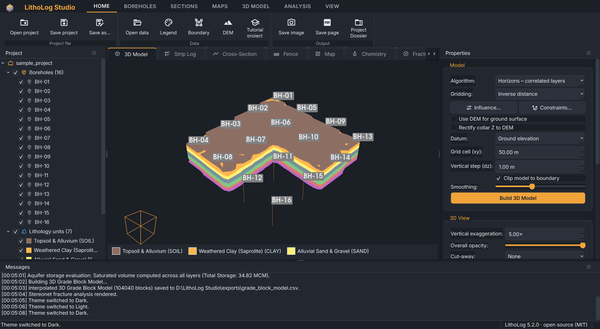

> **Figure 9.2 Technical Specification & Operational Guide**
> 
> • **[OPERATIONAL IDENTITY]:** Complete multi-platform CAD, GIS, 3D Web, and engineering export ecosystem.
> • **[WORKSTATION LOCATION]:** Navigate to the HOME tab, locate the Output group, and click 1-Click Dossier (or navigate to the 3D MODEL tab, locate the Export group).
> • **[STEP-BY-STEP PROCEDURE]:** 1. Click 1-Click Dossier on the HOME tab.
> 2. The engine automatically creates an enterprise ZIP archive containing: `PROJECT_SUMMARY.md`, borehole CSV tables, AutoCAD DXF R12 3D tubes, Google Earth KMZ cylinders, and GEOVIA Surpac STR polylines.
> 3. Individual exports are also available in the 3D MODEL tab.
> • **[INTERFACE ANNOTATION & DETAILS]:** Figure 9.2 summarizes the multi-format export cards: AutoCAD DXF R12, Google Earth KMZ, Surpac STR/DTM, ParaView VTK, Interactive WebGL HTML, and the Complete 1-Click ZIP Dossier.

---

## 10. Complete Ribbon & Shortcut Reference

| Command | Ribbon Location | Shortcut | Detailed Operational Function |
| :--- | :--- | :--- | :--- |
| **New Project** | HOME > Project File > New | **Ctrl+N** | Initializes a clean geological model workspace with default coordinate CRS. |
| **Open Data** | HOME > Data Ingestion > Open Data | **Ctrl+O** | Ingests standardized multi-table Excel workbooks (`.xlsx`) or CSV folders. |
| **Tutorial Project** | HOME > Data Ingestion > Tutorial | — | Loads the pre-configured 16-borehole concession model with all layers in 0.38 s. |
| **Save Project** | HOME > Project File > Save | **Ctrl+S** | Serializes the complete geological model state, layers and scene properties. |
| **1-Click Dossier** | HOME > Output > Project Dossier | **Ctrl+Shift+D** | Bundles all CSVs, CAD DXF, Surpac STR/DTM, and WebGL HTML into a single ZIP. |
| **Strip Log** | BOREHOLES > Logs > Strip Log | **Ctrl+L** | Generates an automated multi-column graphical borehole striplog. |
| **All Logs (PDF)** | BOREHOLES > Logs > All Logs PDF | **Ctrl+Shift+L** | Compiles publication-grade PDF borehole log report book covering all collars. |
| **Validate Data** | BOREHOLES > Check > Validate | **F5** | Executes 12-rule automated data scanner detecting coordinate/depth errors. |
| **USCS Soil** | BOREHOLES > Geotechnical > USCS | — | ASTM D2487 soil classification via grain size and Atterberg plasticity chart. |
| **SPT N60** | BOREHOLES > Geotechnical > SPT N60 | — | Calculates Liao & Whitman effective overburden stress normalized $(N_1)_{60}$ values. |
| **Deere RQD** | BOREHOLES > Geotechnical > Deere RQD | — | Computes Deere Rock Quality Designation rock mass rating distribution. |
| **CWLS LAS** | BOREHOLES > Geotechnical > CWLS LAS | — | Parses and visualizes digital well log curves (Gamma Ray, Resistivity, Density). |
| **3D Survey** | BOREHOLES > Surveys > 3D Survey | — | Computes minimum-curvature 3D directional drilling borehole trajectory. |
| **New Section** | SECTIONS > Cross-Section > New Section | **Ctrl+X** | Correlates multi-borehole 2D cross-sectional profiles with vertical exaggeration. |
| **Fence Diagram** | SECTIONS > Fence > Fence Diagram | **Ctrl+F** | Builds 3D intersecting geological curtain panels via Minimum Spanning Tree. |
| **New Map** | MAPS > Contour Maps > New Map | **Ctrl+M** | Generates 2D Ordinary Kriging or IDW structural elevation contour maps. |
| **Surpac Strings** | MAPS > Surpac CAD > Strings (.str) | — | Exports Format 2 3D polyline string files for Dassault GEOVIA Surpac. |
| **Surpac DTM** | MAPS > Surpac CAD > DTM (.dtm) | — | Exports Delaunay triangulated wireframe mesh models for GEOVIA Surpac. |
| **Build Model** | 3D MODEL > Model > Build Model | **F6** | Builds watertight 3D polygonal solids via VTK marching cubes isosurfacing. |
| **Block Model** | 3D MODEL > Mining > Block Model | **Ctrl+B** | Discretizes 3D regularized mineral block model with interpolated grades. |
| **Grade-Tonnage** | 3D MODEL > Mining > Grade-Tonnage | **Ctrl+G** | Plots recoverable ore tonnage and average grade against cut-off thresholds. |

---

## 11. Troubleshooting & Frequently Asked Questions

### Q1: The 3D model builder fails or indicates non-watertight manifold errors
**Cause:** In complex stratigraphy with severe structural faulting or pinch-outs, raw surface interpolation can cross contact boundaries, producing zero-volume inverted cells.  
**Solution:** Open **3D MODEL > Model > Build Model**. Check 'Enforce Stratigraphic Stacking' and increase Smoothing Iterations to 2. Under the Horizon Constraints tab, set contact relationships to 'Erosional' for top horizons and 'Basement Intrusive' for the bedrock. The engine automatically clamps layer bottoms to upper boundaries.

### Q2: Thin lithological layers appear pinched out or truncated in the 3D solid view
**Cause:** The vertical voxel resolution ($dz$) is coarser than the minimum layer thickness, causing thin units to fall below the sampling threshold.  
**Solution:** In Scene Properties, decrease Vertical Resolution ($dz$) from 2.0 m to 0.5 m or 1.0 m, and enable 'Preserve Thin Intervals' in the Model Builder dialog. This forces sub-voxel refinement along boundary interfaces.

### Q3: My imported GIS boundary shapefile or DEM appears distorted or displaced
**Cause:** Ingesting vector files or elevation rasters in geographic angular degrees (e.g., EPSG:4326 WGS84) instead of projected linear meters.  
**Solution:** Re-project all boundary shapefiles, KMLs, and DEM rasters to an appropriate projected UTM zone (e.g., UTM Zone 43N, EPSG:32643) before importing. LithoLog Studio requires linear metric coordinates for accurate 3D volumetric solids calculations.

### Q4: Striplog geophysical log tracks or well casing elements fail to render
**Cause:** Parameter naming mismatch or missing Depth/To interval columns in the Downhole or Construction Excel sheets.  
**Solution:** Ensure the column headers strictly match: 'Borehole ID', 'Depth (m)', 'Parameter', 'Value' for downhole logs, and 'From (m)', 'To (m)', 'Element' for casing. Use **BOREHOLES > Check > Validate Data (F5)** to scan for missing primary keys before opening the striplog.

### Q5: Surpac .str or .dtm export files fail validation when loaded into GEOVIA Surpac
**Cause:** Exporting coordinate values with truncated decimals or omitting the required Format 2 string identifier lines.  
**Solution:** LithoLog Studio v5.2.0 natively generates standardized Surpac Format 2 ASCII files with exact 3-decimal metric coordinates and matching point-triangle index numbering in `.dtm` files. Ensure the target mining project uses matching UTM coordinate systems.
